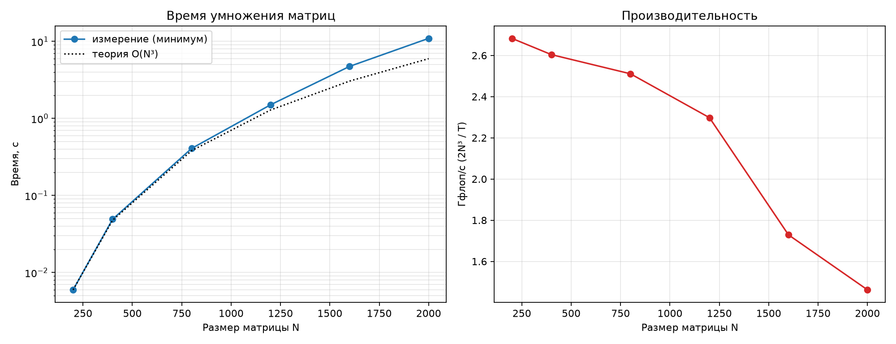

# Лабораторная работа №1 — умножение квадратных матриц (последовательная версия)

**Выполнил:** Левин Григорий, группа 6213-100503D. **Дисциплина:** «Параллельное программирование».

## Задание

> Написать программу на языке C/C++ для перемножения двух квадратных матриц. Исходные данные:
> файл(ы), содержащие значения исходных матриц. Выходные данные: файл со значениями результирующей
> матрицы, время выполнения, объём задачи и др. Обязательна автоматизированная верификация результатов
> вычислений с помощью сторонних библиотек или стороннего ПО (например, на Matlab/Python).
> При желании в качестве экспериментальной задачи можно выбрать любую другую вычислительную задачу,
> которая может быть распараллелена.
>
> Дедлайн по методичке — 05.10.2026.

## Цель работы

Реализовать умножение квадратных вещественных матриц `C = A × B` на C++17 собственными циклами
(без матричных библиотек), измерить время выполнения на матрицах размером от 200 до 2000, проверить
результат независимым расчётом в NumPy и построить графики зависимости времени и производительности
от размера задачи.

## Конфигурация вычислительной системы

| Параметр | Значение |
|---|---|
| Процессор | 13th Gen Intel(R) Core(TM) i5-13500H |
| Ядра / логические потоки | 12 физических (4 производительных + 8 энергоэффективных) / 16 логических |
| Тактовая частота | 3.19 ГГц (номинальная) |
| Оперативная память | 16 ГБ |
| Операционная система | Windows 11, 26H2, сборка 26300 |
| Компилятор | MSVC 19.51.36260 (Visual Studio 18), x64 |
| Флаги компиляции | `/O2 /std:c++17` |
| Python | 3.12.14, NumPy 2.3.5, matplotlib 3.11.2 |
| Тип данных | `double` (8 байт) |

## Структура проекта

| Файл | Назначение |
|---|---|
| `main.cpp` | программа: класс `Matrix`, последовательное умножение, замер времени, вывод метрик |
| `generate.py` | генератор матриц `A.txt` и `B.txt` заданного размера (фиксированный seed) |
| `check.py` | независимая проверка `result.txt` через NumPy |
| `experiment.py` | серия экспериментов по размерам: `results/results.csv`, графики, обновление отчёта |
| `results/results.csv` | таблица замеров: время (среднее и минимальное), операции, память, Гфлоп/с |
| `results/time_vs_size.png` | графики «время от N» и «производительность от N» |
| `A.txt`, `B.txt` | пример исходных матриц 200×200 (генерируются `generate.py`) |
| `requirements.txt` | зависимости Python: NumPy, matplotlib |
| `.gitignore` | исключает бинарники, `result.txt` и служебные каталоги |

## Реализация

Класс `Matrix` хранит элементы в одномерном `vector<double>` (построчно, row-major) и умеет читать
матрицу из файла и записывать результат. Формат файла: в первой строке размер N, далее N строк по N
чисел. Умножение реализовано перегруженным оператором, без сторонних матричных библиотек:

```cpp
Matrix operator*(const Matrix& other) const {
    if (n != other.n) throw runtime_error("Different matrix sizes");
    Matrix result(n);
    for (int i = 0; i < n; ++i)
        for (int k = 0; k < n; ++k) {
            double number = at(i, k);
            for (int j = 0; j < n; ++j)
                result.at(i, j) += number * other.at(k, j);
        }
    return result;
}
```

Для элемента `C[i][j]` вычисляется сумма произведений `A[i][k] · B[k][j]`, то есть на одну пару
(i, j) приходится N умножений и N сложений. Отсюда оценка числа арифметических операций ≈ 2N³ и объём
памяти на три матрицы 3·N²·8 = 24N² байт.

Порядок циклов **i–k–j** выбран не случайно: при нём внутренний цикл идёт по последнему индексу
(`other.at(k, j)`), то есть читает строку `B` последовательно, а строка результата `C[i][*]` остаётся
в кэше. При «школьном» порядке i–j–k внутренний цикл шёл бы по `k`, то есть по столбцам `B`, и каждая
итерация попадала бы в новую строку памяти — это заметно медленнее.

Программа печатает одной строкой: размер задачи, время умножения, оценку числа операций и объём памяти:

```
time_sec=0.407767 N=800 operations=1024000000 memory_bytes=15360000
```

## Сборка

Windows (Developer PowerShell for Visual Studio):

```powershell
cl /EHsc /O2 /std:c++17 main.cpp /Fe:matrix.exe
```

Linux:

```bash
g++ -std=c++17 -O2 main.cpp -o matrix
```

Оптимизация обязательна: без `/O2` (`-O2`) времена вырастают в разы и сравнение с теоретической
кривой O(N³) теряет смысл.

## Запуск

```powershell
py -m pip install -r requirements.txt          # NumPy и matplotlib (один раз)
py generate.py 800                             # матрицы 800x800 -> A.txt, B.txt
.\matrix.exe                                   # умножение, вывод метрик, result.txt
py check.py                                    # проверка результата через NumPy
py experiment.py --exe .\matrix.exe --sizes 200 400 800 1200 1600 2000 --repeats 5
```

`experiment.py` для каждого размера генерирует матрицы, несколько раз запускает программу, сохраняет
`results/results.csv` и `results/time_vs_size.png` и обновляет раздел результатов в этом README.

## Методика эксперимента

- Размеры матриц: **200, 400, 800, 1200, 1600, 2000**.
- Для каждого размера — **5 запусков** умножения; в таблице приводятся среднее и минимальное время
  (минимум меньше подвержен фоновой нагрузке, среднее показывает разброс).
- Замеряется только умножение (`std::chrono::steady_clock`), чтение `A.txt`/`B.txt` и запись
  `result.txt` в измеряемое время не входят.
- После каждого размера результат проверяется независимым расчётом `A @ B` в NumPy.
- Матрицы для всех запусков одного размера одинаковые (фиксированный seed генератора).

## Результаты экспериментов
<!-- RESULTS_START -->

**Условия измерений:** Windows-11-10.0.26300-SP0; Python 3.12.14. Каждый размер: 5 запуск(ов); в таблице — среднее и минимальное время. Время измерено только для умножения, без чтения и записи файлов.

**Исходные данные для графиков** — таблица ниже (по ней построены оба графика). Полные данные лежат в `results/results.csv`.

| N | Время (среднее), с | Время (минимум), с | Операций (2N³) | Память трёх матриц, байт | Гфлоп/с | Проверка |
|---:|---:|---:|---:|---:|---:|:---:|
| 200 | 0.008996 | 0.005964 | 16000000 | 960000 | 2.68 | PASS |
| 400 | 0.052959 | 0.049162 | 128000000 | 3840000 | 2.60 | PASS |
| 800 | 0.428850 | 0.407767 | 1024000000 | 15360000 | 2.51 | PASS |
| 1200 | 1.759734 | 1.504161 | 3456000000 | 34560000 | 2.30 | PASS |
| 1600 | 5.128560 | 4.739298 | 8192000000 | 61440000 | 1.73 | PASS |
| 2000 | 11.432834 | 10.941947 | 16000000000 | 96000000 | 1.46 | PASS |



**Вывод по эксперименту:** при увеличении N время умножения растёт примерно как N³, пока матрицы помещаются в кэш; на больших N измеренная кривая отрывается вверх от теоретической, а производительность одного ядра падает — задача становится ограниченной памятью.
<!-- RESULTS_END -->

## Анализ результатов

**Рост времени.** Минимальное время растёт от 5.96 мс (N = 200) до 10.94 с (N = 2000), то есть примерно
в 1835 раз при росте объёма работ в 1000 раз ((2000/200)³). Пока матрицы помещаются в кэш, рост
кубический: при удвоении размера время увеличивается в 8.24 раза (200→400) и в 8.29 раза (400→800), что
совпадает с теоретическими 8. Дальше рост замедляется: 800→1200 — в 3.69 раза при росте работ в 3.38,
1200→1600 — в 3.15 раза при 2.37.

**Почему замедляется рост.** Причина — память. Три матрицы размера N занимают 24N² байт: при N = 800
это 15 МБ, при N = 1200 — 35 МБ, при N = 2000 — 96 МБ. Начиная примерно с N = 1200 рабочий набор
перестаёт помещаться в кэш последнего уровня, и каждая операция всё чаще требует обращения к
оперативной памяти. Это видно на правом графике: производительность падает с 2.68–2.60 Гфлоп/с
(N = 200…400) до 1.46 Гфлоп/с (N = 2000), то есть в 1.8 раза, хотя арифметика не изменилась.

**Разброс измерений.** На малых размерах время (6–14 мс при N = 200) сопоставимо с разрешением
таймера и с накладными расходами на инициализацию, поэтому среднее отличается от минимума в 1.5 раза.
На средних и больших размерах разброс уже 5–17 % (отношение среднее/минимум — 1.05…1.17), что
объясняется фоновой нагрузкой на машину и нагревом процессора.

**Связь с л/р №2.** Эта программа — отправная точка для л/р №2: в ней тот же алгоритм распараллелен
через OpenMP. Там же показано, что переход от `at(i, j)` к указателям на начало строки позволяет
компилятору векторизовать внутренний цикл и даёт на последовательном пути примерно 1.5–1.7-кратный
выигрыш на малых и средних N: версия л/р №2 показывает около 4 Гфлоп/с против 2.6–2.7 Гфлоп/с здесь.

## Проверка корректности

`check.py` читает `A.txt`, `B.txt` и `result.txt`, независимо перемножает матрицы средствами NumPy
(`A @ B`) и сравнивает результат поэлементно (`np.allclose`, rtol = 1e-9, atol = 1e-7), печатая `PASS`
или `FAIL`. Проверка выполнялась после каждого из 6 размеров — везде **PASS**, максимальное расхождение
с NumPy нулевое в пределах машинной точности. Это подтверждает, что реализация циклов, порядок i–k–j и
чтение/запись файлов корректны.

## Выводы

1. Умножение квадратных матриц реализовано собственными циклами (без библиотек), поэтому его можно
   анализировать и в дальнейшем распараллеливать: сложность ≈ 2N³ арифметических операций, память
   ≈ 24N² байт на три матрицы.
2. Порядок циклов i–k–j даёт последовательный обход строк внутренней матрицы и удержание строки
   результата в кэше; вариант i–j–k обращался бы к памяти по столбцам и работал бы заметно медленнее.
3. Время выполнения растёт как O(N³), пока рабочий набор помещается в кэш (увеличение N вдвое даёт
   ×8.2–8.3 по времени), и медленнее на больших N, где задача упирается в память.
4. Производительность одного ядра падает с 2.68 Гфлоп/с (N = 200) до 1.46 Гфлоп/с (N = 2000) — почти
   вдвое; максимальное измеренное время на N = 2000 составляет около 11 с, то есть время обработки
   ощутимо и пригодно для оценки ускорения в следующих работах.
5. Результаты всех 6 размеров совпали с независимым расчётом NumPy (PASS), значит вычисления корректны.
6. Полученная программа и данные (таблица, графики, `results.csv`) служат базой для л/р №2 (OpenMP),
   где сравнивается последовательная и параллельная версии на одних и тех же матрицах.

## Контрольные вопросы (кратко)

**Какова сложность «наивного» умножения матриц и почему?** O(N³): для каждого из N² элементов
результата выполняется N умножений и N сложений, то есть ≈ 2N³ операций.

**Почему используется порядок циклов i–k–j, а не i–j–k?** При i–k–j внутренний цикл идёт по последнему
индексу и читает память последовательно (строка `B`, строка результата). При i–j–k внутренний цикл идёт
по `k`, то есть по столбцу `B` с шагом N — каждая итерация попадает в новую строку кэша, число
промахов резко растёт.

**Почему на больших N время растёт быстрее, чем «должно»?** Рабочий набор (24N² байт) перестаёт
помещаться в кэш, и скорость начинает ограничивать пропускная способность памяти, а не
производительность арифметики.

**Почему нельзя взять готовую матричную библиотеку?** Библиотеки (BLAS и т. п.) уже оптимизированы и
распараллелены внутри; для учебной задачи нужно показать собственный алгоритм, который затем
распараллеливается в следующих работах.

**Что такое Гфлоп/с и как он посчитан?** Миллиарды операций с плавающей точкой в секунду:
`2N³ / T`, где T — измеренное время умножения.

**Как проверена корректность?** Независимым расчётом в NumPy с сравнением поэлементно по
`np.allclose` (rtol 1e-9, atol 1e-7) — на всех размерах получен PASS.

## Источники

- Л/р №2 этого репозитория — распараллеливание той же программы средствами OpenMP:
  [`../lab2pp`](../lab2pp/)
