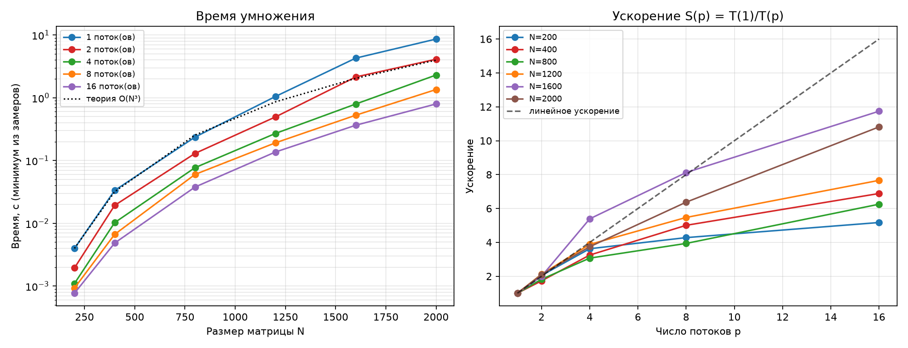
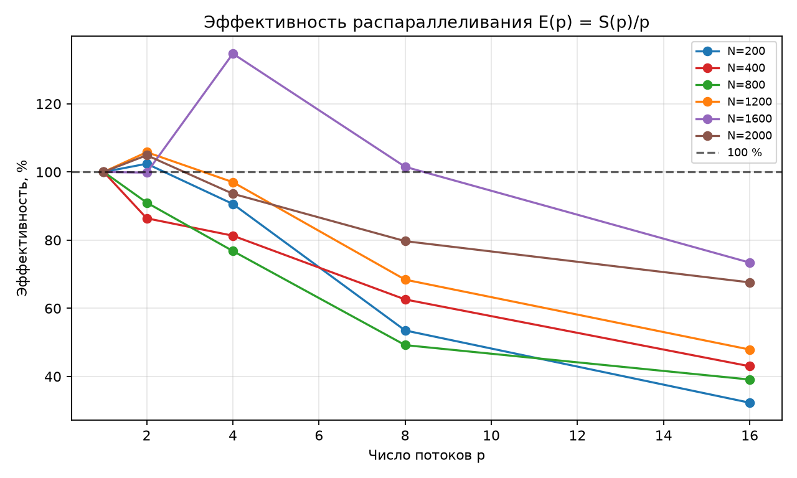

# Лабораторная работа №2 — умножение матриц с использованием OpenMP

**Выполнил:** Левин Григорий, группа 6213-100503D. **Дисциплина:** «Параллельное программирование».

## Задание

> Модифицировать программу из л/р №1 для параллельной работы по технологии OpenMP.
> Провести серию экспериментов с разным количеством потоков (1, 2, 4, 8 и т.д.), разными размерами
> матриц (примерно 200, 400, 800, 1200, 1600, 2000), с разным количеством вычислительных ядер при
> наличии технической возможности (1, 2, 4, 8 и т.д.), иначе использовать фиксированное существующее
> количество вычислительных ядер, например 4.

Дедлайн по методичке — 15.10.2026.

## Цель работы

Перевести программу умножения квадратных матриц из л/р №1 на OpenMP; измерить время выполнения при
разном числе потоков и разных размерах матриц; оценить ускорение, эффективность распараллеливания и
предел по закону Амдала; проверить корректность результата независимым расчётом в NumPy.

## Конфигурация вычислительной системы

| Параметр | Значение |
|---|---|
| Процессор | 13th Gen Intel(R) Core(TM) i5-13500H |
| Ядра / логические потоки | 12 физических (4 производительных + 8 энергоэффективных) / 16 логических |
| Тактовая частота | 3.19 ГГц (номинальная) |
| Оперативная память | 16 ГБ |
| Операционная система | Windows 11, 26H2, сборка 26300 |
| Компилятор | MSVC 19.51.36260 (Visual Studio 18), x64 |
| Флаги компиляции | `/O2 /openmp /std:c++17` (через CMake — тип `Release`) |
| Версия OpenMP | 2.0 (`_OPENMP = 200203`) |
| CMake | 4.3.1 |
| Python | 3.12.14, NumPy 2.3.5, matplotlib 3.11.2 |
| Тип данных | `double` (8 байт) |

Процессор гибридный: 4 производительных ядра поддерживают Hyper-Threading, 8 энергоэффективных —
нет, поэтому при 16 потоках часть работы выполняется на медленных ядрах и на «вторых» потоках P-ядер.

## Структура проекта

| Файл | Назначение |
|---|---|
| `CMakeLists.txt` | сборка C++17 + OpenMP (`OpenMP::OpenMP_CXX`), тип сборки по умолчанию — `Release` |
| `main.cpp` | вся программа: класс `Matrix`, параллельное умножение, параметры командной строки, замеры |
| `generate.py` | генератор матриц `A.txt` и `B.txt` заданного размера (фиксированный seed) |
| `check.py` | независимая проверка `result.txt` через NumPy |
| `experiment.py` | серия экспериментов: размеры × потоки, `benchmark.csv`, `results.txt`, графики, обновление отчёта |
| `benchmark.csv` | таблица замеров (время min/mean, операции, память, Гфлоп/с, ускорение, эффективность) |
| `results.txt` | протокол запусков: команды, сырой вывод программы, результаты проверки |
| `performance.png` | графики «время от N» и «ускорение от числа потоков» |
| `efficiency.png` | график «эффективность от числа потоков» |
| `build.ps1` | сборка напрямую через MSVC (`/openmp`) без CMake |
| `Makefile` | сборка через g++/clang++ (`-fopenmp`) без CMake |
| `requirements.txt` | зависимости Python: NumPy, matplotlib |
| `.gitignore` | исключает бинарники, каталоги сборки и сгенерированные матрицы |

## Алгоритм и распараллеливание

Алгоритм тот же, что в л/р №1: три вложенных цикла в порядке **i–k–j**, умножение реализовано вручную,
без сторонних матричных библиотек. Сложность — O(N³) (около 2N³ арифметических операций), память —
24·N² байт на три матрицы.

Параллеливание — одна директива OpenMP на внешнем цикле по строкам:

```cpp
Matrix multiply(const Matrix& a, const Matrix& b, int threads) {
    if (a.size() != b.size()) throw runtime_error("Different matrix sizes");
    const int n = a.size();
    Matrix result(n);
#pragma omp parallel for schedule(static) num_threads(threads)
    for (int i = 0; i < n; ++i) {
        double* c = result.row(i);
        for (int k = 0; k < n; ++k) {
            const double number = a.row(i)[k];
            const double* other = b.row(k);
            for (int j = 0; j < n; ++j) c[j] += number * other[j];
        }
    }
    return result;
}
```

Почему распараллелен именно внешний цикл:

- **итерации независимы** — строка `C[i][*]` зависит только от `A[i][*]` и всей `B`;
- **гонок нет** — поток пишет только в свою полосу строк результата, `A` и `B` только читаются,
  а неявный барьер в конце `parallel for` гарантирует, что результат готов целиком;
- **нет ложного разделения (false sharing)** — строки длиной `8·N` байт лежат в разных линиях кэша,
  блоки строк потоков не пересекаются;
- **хорошая локальность** — при `schedule(static)` поток получает непрерывный диапазон строк, строка
  `A[i]` и блок результата переиспользуются из кэша, чтение `B` идёт последовательно;
- **крупное зерно** — внутренние циклы содержат N итераций, поэтому накладные расходы на параллельную
  секцию малы по сравнению с полезной работой при больших N.

Внутренний цикл по `j` распараллеливать невыгодно: понадобились бы `atomic`/`reduction` на каждую
запись `C[i][j]`, то есть синхронизация в самом горячем месте.

`schedule(static)` выбран как компромисс: накладных расходов нет, но при 16 потоках на 12 физических
ядрах и разной скорости P- и E-ядер возможен дисбаланс (обсуждается в разделе «Анализ результатов»).

## Что изменилось по сравнению с л/р №1

1. Подключён `omp.h`; при сборке без OpenMP подставляются заглушки, и программа работает последовательно.
2. Умножение вынесено в функцию `multiply(a, b, threads)`, внешний цикл сделан параллельным.
3. Во внутренних циклах используются указатели на начало строки (`row(i)`) вместо `at(i, j)`.
   Это не меняет алгоритм, но позволяет компилятору векторизовать внутренний цикл — на последовательном
   пути такая правка даёт ускорение в 1.2–1.8 раза (см. контрольный замер в разделе результатов).
4. Добавлены параметры командной строки и вывод метрик одной строкой (см. ниже).
5. Добавлен прогрев (`--warmup`): не входящий в замер запуск, который поднимает частоту процессора
   и заполняет кэш, — иначе первый замер оказывается заметно медленнее остальных.
6. Появились `CMakeLists.txt`, `experiment.py` (серия экспериментов, CSV, протокол, графики).

## Сборка

### CMake (рекомендуется, одинаково на Windows и Linux)

```powershell
cmake -S . -B build
cmake --build build --config Release
```

На Windows используется генератор по умолчанию (Visual Studio), бинарник появится в
`build\Release\matrix.exe`; на Linux — в `build/matrix`.

> Тип сборки важен: при `-O0`/`/Od` времена вырастают в разы, и сравнение с теоретической кривой O(N³)
> теряет смысл. В `CMakeLists.txt` тип по умолчанию выставлен в `Release`, а для многоконфигурационного
> генератора нужно явно указывать `--config Release`.

### Без CMake

Windows (Developer PowerShell for Visual Studio):

```powershell
cl /EHsc /O2 /openmp /std:c++17 main.cpp /Fe:matrix.exe   # или .\build.ps1
```

Linux:

```bash
make                     # g++ -O2 -std=c++17 -fopenmp
```

Без ключа `/openmp` (`-fopenmp`) программа собирается и работает, но последовательно.

## Запуск

```powershell
py -m pip install -r requirements.txt      # NumPy и matplotlib (один раз)
py generate.py 800                         # матрицы 800x800 -> A.txt, B.txt
.\build\Release\matrix.exe --threads 8 --repeats 5
py check.py                                # проверка результата через NumPy
py experiment.py --exe .\build\Release\matrix.exe --repeats 5
```

Параметры `matrix.exe`:

| Параметр | По умолчанию | Значение |
|---|---|---|
| `--threads p` | `omp_get_max_threads()` | число потоков OpenMP |
| `--repeats R` | 1 | сколько раз умножить; выводятся среднее и минимальное время |
| `--warmup W` | 1 | число «прогревных» умножений, не входящих в замер |
| `--a`, `--b`, `--out` | `A.txt`, `B.txt`, `result.txt` | файлы исходных матриц и результата |
| `--help` | — | краткая справка |

Пример вывода:

```
$ .\matrix.exe --threads 8 --repeats 5 --warmup 1
N=800 threads=8 repeats=5 warmup=1 time_sec=0.061640 time_min_sec=0.059969 operations=1024000000 memory_bytes=15360000 gflops=17.072 omp_procs=16
```

То есть печатаются размер задачи, число потоков, число замеров, среднее и минимальное время
умножения, оценка числа операций (`2N³`), объём памяти трёх матриц (`24N²`), производительность
в Гфлоп/с и число доступных процессоров.

`experiment.py` дополнительно поддерживает `--charts-only` — перерисовать графики по уже готовому
`benchmark.csv`, не повторяя замеры, и `--serial-exe <путь>` — контрольный замер программы л/р №1
на тех же матрицах (см. раздел результатов).

## Методика эксперимента

- Размеры матриц: **200, 400, 800, 1200, 1600, 2000** (как в задании).
- Число потоков: **1, 2, 4, 8, 16** — вплоть до всех доступных логических процессоров.
- Для каждого размера матрицы генерируются один раз и используются для всех вариантов числа потоков,
  поэтому сравниваются одинаковые данные.
- В каждой точке — 1 прогрев + 5 замеров; в таблицах приводится **минимальное** время (минимум меньше
  подвержен влиянию фоновой нагрузки; среднее сохраняется в `benchmark.csv`).
- Замеряется только умножение (`std::chrono::steady_clock`), чтение и запись файлов не входят.
- После каждой точки результат проверяется независимым вычислением `A @ B` в NumPy.
- Полный протокол запусков (команды, сырой вывод, результаты проверок) сохраняется в `results.txt`.

**О количестве вычислительных ядер.** Отключить часть ядер на рабочей машине нельзя, поэтому «разное
количество ядер» моделируется числом потоков OpenMP: при `p` потоках в счёте реально участвуют `p`
логических процессоров. Дополнительно учтено, что физических ядер 12, а логических 16, то есть при
`p = 16` потоки делят P-ядра (Hyper-Threading) и часть из них попадает на медленные E-ядра.

## Результаты экспериментов
<!-- RESULTS_START -->
**Условия измерений:** Windows-11-10.0.26300-SP0; логических процессоров: 16; Python 3.12.14; число замеров на точку: 5 (+1 прогрев(ов)); в таблицах — минимальное время из замеров. Время измеряется только для умножения, без чтения и записи файлов. Верификация NumPy: **PASS** для всех 30 точек.

**Исходные данные для графиков** — таблицы ниже: по времени построена левая панель `performance.png`, по ускорению — правая, по эффективности — `efficiency.png`. Полные данные с временем min/mean лежат в `benchmark.csv`, протокол прогонов — в `results.txt`.

**Время умножения T(p), с:**

| N | p=1 | p=2 | p=4 | p=8 | p=16 |
|---:|---:|---:|---:|---:|---:|
| 200 | 0.003977 | 0.001942 | 0.001097 | 0.000929 | 0.000769 |
| 400 | 0.033298 | 0.019266 | 0.010241 | 0.006650 | 0.004837 |
| 800 | 0.236165 | 0.129712 | 0.076908 | 0.059969 | 0.037774 |
| 1200 | 1.045822 | 0.494118 | 0.269562 | 0.191165 | 0.136522 |
| 1600 | 4.279587 | 2.143365 | 0.794062 | 0.526865 | 0.364506 |
| 2000 | 8.615640 | 4.106930 | 2.301874 | 1.351838 | 0.796716 |

**Ускорение S(p) = T(1)/T(p):**

| N | p=1 | p=2 | p=4 | p=8 | p=16 |
|---:|---:|---:|---:|---:|---:|
| 200 | 1.00 | 2.05 | 3.62 | 4.28 | 5.17 |
| 400 | 1.00 | 1.73 | 3.25 | 5.01 | 6.88 |
| 800 | 1.00 | 1.82 | 3.07 | 3.94 | 6.25 |
| 1200 | 1.00 | 2.12 | 3.88 | 5.47 | 7.66 |
| 1600 | 1.00 | 2.00 | 5.39 | 8.12 | 11.74 |
| 2000 | 1.00 | 2.10 | 3.74 | 6.37 | 10.81 |

**Эффективность E(p) = S(p)/p:**

| N | p=1 | p=2 | p=4 | p=8 | p=16 |
|---:|---:|---:|---:|---:|---:|
| 200 | 100.0 % | 102.4 % | 90.6 % | 53.5 % | 32.3 % |
| 400 | 100.0 % | 86.4 % | 81.3 % | 62.6 % | 43.0 % |
| 800 | 100.0 % | 91.0 % | 76.8 % | 49.2 % | 39.1 % |
| 1200 | 100.0 % | 105.8 % | 97.0 % | 68.4 % | 47.9 % |
| 1600 | 100.0 % | 99.8 % | 134.7 % | 101.5 % | 73.4 % |
| 2000 | 100.0 % | 104.9 % | 93.6 % | 79.7 % | 67.6 % |

**Производительность, Гфлоп/с (2N³ / T(p)):**

| N | p=1 | p=2 | p=4 | p=8 | p=16 |
|---:|---:|---:|---:|---:|---:|
| 200 | 4.02 | 8.24 | 14.59 | 17.22 | 20.81 |
| 400 | 3.84 | 6.64 | 12.50 | 19.25 | 26.46 |
| 800 | 4.34 | 7.89 | 13.31 | 17.07 | 27.11 |
| 1200 | 3.31 | 6.99 | 12.82 | 18.08 | 25.32 |
| 1600 | 1.91 | 3.82 | 10.32 | 15.55 | 22.47 |
| 2000 | 1.86 | 3.90 | 6.95 | 11.84 | 20.08 |

**Контрольный замер: программа л/р №1 на тех же матрицах** (тот же компилятор и флаги, та же машина):

| N | л/р №1 (последовательно), с | л/р №2, p=1, с | Отношение |
|---:|---:|---:|---:|
| 200 | 0.006024 | 0.003977 | 1.51 |
| 400 | 0.050775 | 0.033298 | 1.52 |
| 800 | 0.414536 | 0.236165 | 1.76 |
| 1200 | 1.502119 | 1.045822 | 1.44 |
| 1600 | 5.008682 | 4.279587 | 1.17 |
| 2000 | 11.601864 | 8.615640 | 1.35 |




<!-- RESULTS_END -->

## Анализ результатов

**Зависимость от размера задачи.** При одном потоке время растёт примерно как N³, пока матрицы
помещаются в кэш: 200→400 — в 8.37 раза (объём работ — в 8 раз), 400→800 — в 7.09 раза. Дальше рост
обгоняет кубический закон: 800→1200 — в 4.43 раза при росте работ в 3.38, 1200→1600 — в 4.09 раза при
2.37. Причина — память: при N = 800 три матрицы занимают 15 МБ, при N = 1200 — 35 МБ, при N = 2000 —
96 МБ, и рабочий набор перестаёт помещаться в кэш последнего уровня. Поэтому производительность
одного потока падает с 3.8–4.3 Гфлоп/с (N = 200…800) до 1.86–1.91 Гфлоп/с (N = 1600, 2000), то есть
примерно в 2.3 раза. На графике это видно как отрыв измеренных кривых от пунктирной линии O(N³) на
больших N.

**Сравнение с л/р №1.** Программа л/р №1, собранная тем же компилятором и с теми же флагами, на тех же
матрицах работает в 1.17–1.76 раза медленнее, чем параллельная версия при `p = 1`. Это эффект не
OpenMP (при одном потоке директива не даёт ускорения), а перехода от `at(i, j)` к указателям на строку:
внутренний цикл `c[j] += number * other[j]` становится векторизуемым. На больших N выигрыш сокращается
до 1.17–1.35 раза, потому что задача упирается в память, а не в арифметику. Важно, что однопоточный
режим остаётся эквивалентным последовательной программе — распараллеливание не замедляет код.

**Ускорение.** Оно растёт и с числом потоков, и с размером задачи: максимум **11.74 раза на 16 потоках**
при N = 1600 (эффективность 73.4 %), при N = 2000 — 10.81 раза (67.6 %). При `p = 2` ускорение близко
к двум (1.73–2.12), то есть два потока утилизируются почти идеально: два P-ядра не конкурируют за общие
ресурсы.

**Эффективность.** С ростом `p` эффективность падает, и тем сильнее, чем меньше N:

1. **Накладные расходы OpenMP** — запуск потоков, распределение итераций и барьер в конце
   параллельной секции. При N = 200 на 16 потоков приходится всего 12–13 строк на поток, и
   эффективность падает до 32.3 %, а при N = 1600 — 73.4 %.
2. **Пропускная способность памяти.** Все потоки читают общую матрицу B; на больших N программа
   упирается в память, и добавление потоков даёт всё меньше.
3. **Неоднородные ядра и переподписка.** Физических ядер 12, а потоков до 16: «лишние» потоки делят
   P-ядра (Hyper-Threading), а часть потоков попадает на медленные E-ядра. При `schedule(static)`
   строки делятся поровну, поэтому поток на E-ядре становится тормозом всей секции.

**Эффективность выше 100 %** в отдельных точках (N = 1600, p = 4 — 134.7 %; N = 2000, p = 2 — 104.9 %)
не является ошибкой измерения «в пользу параллельной версии». Основная причина — кэш: при `p` потоках
каждый поток получает 1/p строк `A` и результата, его рабочий набор уменьшается и лучше помещается в
личный кэш L1/L2, поэтому один поток в параллельной версии работает быстрее, чем единственный поток
последовательной (это сверхлинейное ускорение, известный эффект для задач, ограниченных кэшем). Второй
вклад даёт разброс замеров: среднее время превышает минимум в 1.02–1.80 раза, поэтому к значениям
эффективности на краях диапазона следует относиться как к оценке.

**Оценка последовательной доли по закону Амдала.** Из S(p) = 1 / (α + (1−α)/p) при p = 16:

| N | 200 | 400 | 800 | 1200 | 1600 | 2000 |
|---|---:|---:|---:|---:|---:|---:|
| S(16) | 5.17 | 6.88 | 6.25 | 7.66 | 11.74 | 10.81 |
| Оценка α | 14.0 % | 8.8 % | 10.4 % | 7.3 % | 2.4 % | 3.2 % |

Эффективная «последовательная» доля падает с ростом N примерно с 14 % до 3 %: фиксированные накладные
расходы амортизируются на большой задаче. Немонотонность (8.8 % при N = 400 против 10.4 % при N = 800)
объясняется разбросом замеров. Здесь α — эффективная величина: она включает и накладные расходы
OpenMP, и потери из-за пропускной способности памяти.

**Предел ускорения.** При α = 2.4 % закон Амдала даёт максимум 1/α ≈ 42 раза при бесконечном числе
потоков. Реально более высокое ускорение ограничат память и неоднородные ядра. Дальнейшие шаги —
кэш-блокирование (плиточное умножение), `schedule(dynamic, chunk)` для выравнивания загрузки на
гибридных ядрах, векторизация внутреннего цикла (`/arch:AVX2`, `#pragma omp simd`).

## Проверка корректности

`check.py` читает `A.txt`, `B.txt`, `result.txt`, считает эталон `A @ B` в NumPy и сравнивает
поэлементно (`np.allclose`, rtol = 1e-9, atol = 1e-7), печатая `PASS` или `FAIL`. Проверка выполняется
после каждой из 30 точек эксперимента (6 размеров × 5 вариантов числа потоков) — во всех точках
получен **PASS**. Значит, распараллеливание не изменило результат: гонок данных и потери обновлений
нет. Результаты проверок сохранены в `results.txt`.

## Выводы

1. Программа л/р №1 переведена на OpenMP: распараллелен внешний цикл по строкам результата
   (`#pragma omp parallel for schedule(static) num_threads(p)`), алгоритм и формат файлов сохранены,
   в вычислительной части изменились единицы строк.
2. Распараллеливание по строкам не создаёт гонок данных и не меняет результат: все 30 точек совпали
   с расчётом NumPy с точностью до машинной погрешности.
3. Последовательный путь не ухудшился: при `p = 1` версия л/р №2 в 1.17–1.76 раза быстрее исходной
   программы л/р №1 на тех же матрицах (эффект векторизации внутреннего цикла).
4. Время растёт как O(N³), пока рабочий набор помещается в кэш; начиная с N ≈ 1200 рост ускоряется,
   а производительность одного потока падает с 3.8–4.3 до 1.86–1.91 Гфлоп/с.
5. Ускорение растёт с числом потоков и размером задачи: до **11.74 раза на 16 потоках** при N = 1600
   (эффективность 73.4 %) и 10.81 раза при N = 2000; максимальная производительность — около
   27 Гфлоп/с.
6. Эффективность падает с ростом `p` и уменьшением N (до 32 % при N = 200, p = 16) из-за накладных
   расходов OpenMP, ограниченной пропускной способности памяти и неоднородности ядер (4 P-ядра +
   8 E-ядер, 16 логических процессоров).
7. Оценка эффективной последовательной доли по Амдалу уменьшается с 14 % (N = 200) до 3 % (N = 2000),
   то есть на больших задачах распараллеливание окупается гораздо лучше.
8. OpenMP позволяет распараллелить готовую последовательную программу минимальными изменениями, но
   для матриц большого размера ускорение ограничено памятью, а не числом потоков.

## Контрольные вопросы (кратко)

**Что такое OpenMP?** Набор директив компилятора, функций и переменных окружения для параллельного
программирования систем с общей памятью; реализован как расширение компилятора (модель fork–join).

**Чем `parallel for` отличается от `parallel`?** `parallel` создаёт команду потоков, и каждый поток
выполняет весь блок; `parallel for` дополнительно распределяет итерации следующего цикла между потоками.

**Откуда берутся гонки данных и почему их нет в этой работе?** Гонка — одновременная запись в одну
ячейку из разных потоков. Здесь поток пишет только в закреплённые за ним строки, а `A` и `B` только
читаются, поэтому синхронизация внутри цикла не нужна.

**Что такое ложное разделение (false sharing)?** Потоки пишут в разные переменные, попавшие в одну
линию кэша; линия «перебрасывается» между ядрами, производительность падает. В работе строки длиной
8N байт гарантируют, что блоки потоков не пересекаются по линиям кэша.

**Что даёт `schedule(static)` и чем он отличается от `dynamic`?** `static` делит итерации заранее
равными непрерывными блоками (минимум накладных расходов, хорошая локальность, но возможен дисбаланс);
`dynamic` выдаёт итерации по мере освобождения потоков (лучший баланс, больше накладных расходов).

**Почему ускорение меньше числа потоков?** Закон Амдала (накладные расходы, доля последовательного
кода), ограниченная пропускная способность памяти, дисбаланс загрузки и разная скорость ядер.

**Зачем нужен прогрев перед замером?** Первый запуск идёт на пониженной частоте и с «холодным» кэшем,
поэтому он заметно медленнее установившегося режима и искажает результат.

## Источники

- OpenMP Application Programming Interface. — <https://www.openmp.org/specifications/>
- Microsoft Learn: поддержка OpenMP в MSVC (`/openmp`) — <https://learn.microsoft.com/cpp/build/reference/openmp-enable-openmp-2-0-support>
- Л/р №1 этого репозитория (последовательная версия): [`../lab1pp`](../lab1pp/)
