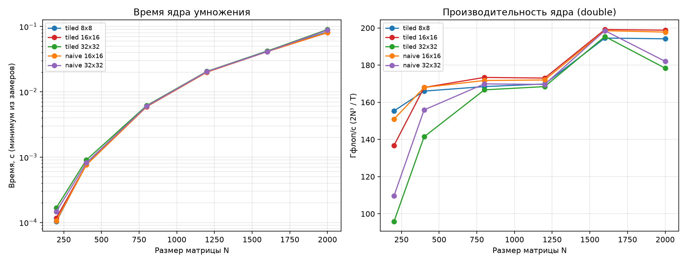
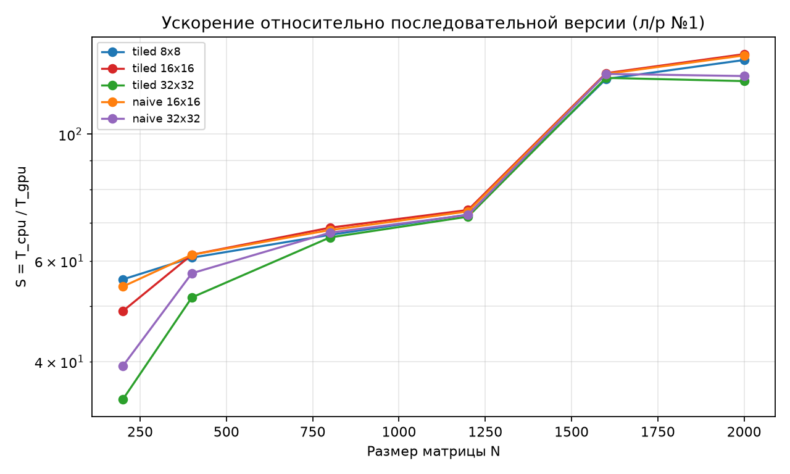

# Лабораторная работа №4 — умножение матриц на CUDA

**Выполнил:** Левин Григорий, группа 6213-100503D. **Дисциплина:** «Параллельное программирование».

## Задание

> Модифицировать программу из л/р №1 для параллельной работы по технологии CUDA. Провести
> эксперименты с разными размерами матриц и различными конфигурациями сетки блоков.
>
> Дедлайн по методичке — 02.12.2026.

## Цель работы

Перенести умножение квадратных матриц `C = A × B` из л/р №1 на GPU средствами CUDA: реализовать
«наивное» ядро (один поток на элемент результата) и плиточное ядро с разделяемой памятью, провести
серию экспериментов с разными размерами матриц (200…2000) и разными конфигурациями блоков,
сравнить время и производительность с последовательной версией, проверить результат независимым
расчётом в NumPy и выяснить, что именно ограничивает скорость GPU-версии.

## Конфигурация вычислительной системы

| Параметр | Значение |
|---|---|
| Видеокарта | NVIDIA GeForce RTX 4050 Laptop GPU |
| Compute capability | 8.9 (Ada Lovelace), 20 мультипроцессоров (SM) |
| Видеопамять / кэш L2 | 6 ГБ / 24 МБ, шина памяти 96 бит |
| Драйвер NVIDIA | 616.92 (CUDA driver API 13.4) |
| CUDA Toolkit | 13.5 (`nvcc` V13.5.37), runtime 13.4 |
| Флаги компиляции | `-O2 -arch=sm_89` |
| Процессор | 13th Gen Intel(R) Core(TM) i5-13500H (12 ядер / 16 потоков) |
| Оперативная память | 16 ГБ |
| Операционная система | Windows 11, 26H2, сборка 26300 |
| Компилятор хоста | MSVC 19.51.36260 (Visual Studio 18), x64 |
| Python | 3.12.14, NumPy 2.3.5, matplotlib 3.11.2 |
| Тип данных | `double` (8 байт) |

## Структура проекта

| Файл | Назначение |
|---|---|
| `main.cu` | оба ядра умножения, копирование данных, замеры, параметры командной строки, вывод метрик |
| `flops_test.cu` | контрольный замер пиковой производительности GPU в FP64 и FP32 |
| `generate.py` | генератор матриц `A.txt` и `B.txt` заданного размера (фиксированный seed) |
| `check.py` | независимая проверка `result.txt` через NumPy |
| `experiment.py` | серия экспериментов: размеры × конфигурации блоков, `benchmark.csv`, `results.txt`, графики, обновление отчёта |
| `benchmark.csv` | таблица замеров: время ядра, время копирования, Гфлоп/с, ускорение относительно CPU |
| `results.txt` | протокол запусков: команды, сырой вывод программы, результаты проверки |
| `performance.png` | графики «время от N» и «производительность от N» |
| `speedup.png` | ускорение относительно последовательной версии |
| `CMakeLists.txt` | сборка через CMake (язык CUDA, архитектура 89) |
| `build.ps1` | сборка напрямую через `nvcc` (Windows) |
| `Makefile` | сборка напрямую через `nvcc` (Linux) |
| `requirements.txt` | зависимости Python: NumPy, matplotlib |
| `.gitignore` | исключает бинарники, каталоги сборки и сгенерированные матрицы |

## Реализация

В работе два ядра — чтобы показать, как влияет способ работы с памятью при одинаковом результате.

**1. Наивное ядро.** Один поток вычисляет один элемент `C[i][j]`: читает строку `A` и столбец `B`
напрямую из глобальной памяти.

```cpp
__global__ void multiplyNaive(const double* a, const double* b, double* c, int n) {
    const int col = blockIdx.x * blockDim.x + threadIdx.x;
    const int row = blockIdx.y * blockDim.y + threadIdx.y;
    if (row >= n || col >= n) return;
    const double* aRow = a + static_cast<size_t>(row) * n;
    double sum = 0.0;
    for (int k = 0; k < n; ++k) sum += aRow[k] * b[static_cast<size_t>(k) * n + col];
    c[static_cast<size_t>(row) * n + col] = sum;
}
```

**2. Плиточное ядро с разделяемой памятью.** Блок потока `TILE × TILE` загружает плитки `A` и `B`
в `__shared__`-память и переиспользует их для всех элементов своего блока результата. На одну
загрузку элемента из глобальной памяти приходится `TILE` умножений, поэтому нагрузка на память
уменьшается в `TILE` раз.

```cpp
template <int TILE>
__global__ void multiplyTiled(const double* a, const double* b, double* c, int n) {
    __shared__ double tileA[TILE][TILE];
    __shared__ double tileB[TILE][TILE];

    const int tx = threadIdx.x, ty = threadIdx.y;
    const int row = blockIdx.y * TILE + ty, col = blockIdx.x * TILE + tx;
    const int tiles = (n + TILE - 1) / TILE;

    double sum = 0.0;
    for (int t = 0; t < tiles; ++t) {
        const int aCol = t * TILE + tx, bRow = t * TILE + ty;
        tileA[ty][tx] = (row < n && aCol < n) ? a[static_cast<size_t>(row) * n + aCol] : 0.0;
        tileB[ty][tx] = (bRow < n && col < n) ? b[static_cast<size_t>(bRow) * n + col] : 0.0;
        __syncthreads();
        #pragma unroll
        for (int k = 0; k < TILE; ++k) sum += tileA[ty][k] * tileB[k][tx];
        __syncthreads();
    }
    if (row < n && col < n) c[static_cast<size_t>(row) * n + col] = sum;
}
```

Размер стороны блока/плитки задаётся параметром `--block 8|16|32`, поэтому одна и та же программа
прогоняет разные конфигурации сетки блоков: сетка имеет размер `ceil(N/B) × ceil(N/B)`, в блоке
`B × B` потоков. Для размеров, не кратных `B`, края обрабатываются проверками (и нулевыми
добавками в плитках), поэтому результат для всех N совпадает с CPU-версией.

**Хост-часть:** матрицы читаются из `A.txt`/`B.txt` (формат л/р №1), копируются в GPU
(`cudaMemcpy`), ядро запускается `--warmup` раз для прогрева, затем `--repeats` раз с замером
событиями CUDA:

```cpp
for (int i = 0; i < warmup; ++i) launch();          // прогрев, не входит в замер
for (int repeat = 0; repeat < repeats; ++repeat) {  // 5 замеров, берём минимум
    cudaEventRecord(start); launch(); cudaEventRecord(stop);
    cudaEventSynchronize(stop);
    cudaEventElapsedTime(&ms, start, stop);
}
```

Время копирования `H2D` и `D2H` замеряется отдельно (`h2d_sec`, `d2h_sec`) и в основном времени ядра
не учитывается — так же, как в л/р №1–3 из времени исключалось чтение и запись файлов.

## Сборка

### CMake (рекомендуется)

```powershell
cmake -S . -B build
cmake --build build --config Release
```

Бинарник появится в `build\Release\matrix_cuda.exe` (Windows) или `build/matrix_cuda` (Linux).
Архитектура GPU задаётся в `CMakeLists.txt` (`CMAKE_CUDA_ARCHITECTURES`, по умолчанию 89);
для RTX 30xx нужно поставить 86, для RTX 50xx — 120.

### Напрямую через nvcc

```powershell
nvcc -O2 -arch=sm_89 main.cu -o matrix_cuda.exe     # или .\build.ps1
nvcc -O2 -arch=sm_89 flops_test.cu -o flops_test.exe
```

Linux: `make` (или `nvcc -O2 -arch=sm_89 main.cu -o matrix_cuda`). Требуется установленный CUDA Toolkit
и, на Windows, окружение MSVC в `PATH` — проще всего запускать из «Developer PowerShell for Visual
Studio».

## Запуск

```powershell
py -m pip install -r requirements.txt       # NumPy и matplotlib (один раз)
py generate.py 800                          # матрицы 800x800 -> A.txt, B.txt
.\build\Release\matrix_cuda.exe --kernel tiled --block 16 --repeats 5
py check.py                                 # проверка результата через NumPy
py experiment.py --exe .\build\Release\matrix_cuda.exe --cpu-exe ..\lab1pp\matrix.exe --repeats 5
.\flops_test.exe                            # контрольный замер FP64/FP32
```

Параметры `matrix_cuda.exe`:

| Параметр | По умолчанию | Значение |
|---|---|---|
| `--kernel naive\|tiled` | `tiled` | какое ядро запускать |
| `--block B` | 16 | сторона блока/плитки: 8, 16 или 32 (для `naive` — любой до 32) |
| `--repeats R` | 1 | число замеров ядра (выводятся среднее и минимум) |
| `--warmup W` | 1 | число прогревных запусков, не входящих в замер |
| `--a`, `--b`, `--out` | `A.txt`, `B.txt`, `result.txt` | файлы матриц и результата |

Пример вывода:

```
N=800 kernel=tiled block=16x16 grid=50x50 repeats=5 warmup=1 time_sec=0.005987 time_min_sec=0.005906 h2d_sec=0.001450 d2h_sec=0.000864 operations=1024000000 memory_bytes=15360000 gflops=173.383 device="NVIDIA GeForce RTX 4050 Laptop GPU" sm=89
```

## Методика эксперимента

- Размеры матриц: **200, 400, 800, 1200, 1600, 2000** (как в л/р №2).
- Конфигурации: **tiled 8×8, tiled 16×16, tiled 32×32** (плиточное ядро, три размера блока) и
  **naive 16×16, naive 32×32** (наивное ядро, два размера блока) — всего 5 конфигураций × 6
  размеров = 30 точек.
- В каждой точке: 1 прогрев + 5 замеров ядра, в таблицах — минимум (среднее лежит в `benchmark.csv`).
- Замер только ядра (события CUDA); копирование `H2D`/`D2H` измеряется отдельно.
- После каждой точки результат проверяется независимым расчётом `A @ B` в NumPy.
- Для ускорения относительно CPU та же матрица считается программой л/р №1 (3 запуска, берётся
  минимум); ускорение `S = T_cpu / T_gpu`.
- Полный протокол запусков (команды, сырой вывод, проверки) — в `results.txt`.

## Результаты экспериментов
<!-- RESULTS_START -->
**Условия измерений:** Windows-11-10.0.26300-SP0; Python 3.12.14; замеров на точку: 5 (+1 прогрев(ов)), в таблицах — минимум; время ядра измеряется событиями CUDA и не включает копирование данных в GPU и обратно. Верификация NumPy: **PASS** для всех 30 точек.

**Исходные данные для графиков** — таблицы ниже (по ним построены графики), полные данные с временем копирования лежат в `benchmark.csv`.

**Время ядра, мс:**

| N | tiled 8x8 | tiled 16x16 | tiled 32x32 | naive 16x16 | naive 32x32 |
|---:|---:|---:|---:|---:|---:|
| 200 | 0.103 | 0.117 | 0.167 | 0.106 | 0.146 |
| 400 | 0.771 | 0.762 | 0.905 | 0.762 | 0.821 |
| 800 | 6.079 | 5.906 | 6.143 | 5.963 | 6.027 |
| 1200 | 20.348 | 19.974 | 20.518 | 20.091 | 20.376 |
| 1600 | 42.105 | 41.133 | 41.924 | 41.263 | 41.260 |
| 2000 | 82.408 | 80.478 | 89.720 | 80.899 | 87.908 |

**Производительность, Гфлоп/с (2N³ / T):**

| N | tiled 8x8 | tiled 16x16 | tiled 32x32 | naive 16x16 | naive 32x32 |
|---:|---:|---:|---:|---:|---:|
| 200 | 155.3 | 136.8 | 95.8 | 150.9 | 109.6 |
| 400 | 166.0 | 168.0 | 141.4 | 168.0 | 155.9 |
| 800 | 168.4 | 173.4 | 166.7 | 171.7 | 169.9 |
| 1200 | 169.8 | 173.0 | 168.4 | 172.0 | 169.6 |
| 1600 | 194.6 | 199.2 | 195.4 | 198.5 | 198.5 |
| 2000 | 194.2 | 198.8 | 178.3 | 197.8 | 182.0 |

**Ускорение относительно последовательной версии (л/р №1), S = T_cpu / T_gpu:**

| N | tiled 8x8 | tiled 16x16 | tiled 32x32 | naive 16x16 | naive 32x32 |
|---:|---:|---:|---:|---:|---:|
| 200 | 55.7× | 49.0× | 34.4× | 54.1× | 39.3× |
| 400 | 60.8× | 61.5× | 51.8× | 61.5× | 57.1× |
| 800 | 66.7× | 68.6× | 66.0× | 68.0× | 67.2× |
| 1200 | 72.3× | 73.7× | 71.7× | 73.3× | 72.2× |
| 1600 | 124.9× | 127.8× | 125.4× | 127.5× | 127.5× |
| 2000 | 134.8× | 138.0× | 123.8× | 137.3× | 126.4× |

**Время копирования данных (наибольшее по конфигурациям):**

| N | H2D, мс | D2H, мс |
|---:|---:|---:|
| 200 | 0.177 | 0.113 |
| 400 | 0.874 | 0.278 |
| 800 | 1.474 | 0.880 |
| 1200 | 2.854 | 1.768 |
| 1600 | 6.135 | 3.794 |
| 2000 | 8.053 | 6.492 |




<!-- RESULTS_END -->

## Анализ результатов

**Рост времени с размером задачи.** Время ядра растёт почти как N³: 400→800 — в 7.75 раза при росте
объёма работ в 8 раз, 800→1200 — в 3.38 раза (работы — 3.38), 1200→1600 — в 2.06 раза (2.37),
1600→2000 — в 1.96 раза (1.95). От 200 до 2000 время выросло в 690–800 раз при росте работ в 1000 раз,
то есть на больших N GPU работает даже эффективнее (лучше загружены SM), а на малых заметнее
накладные расходы.

**Производительность и её предел.** На больших размерах все конфигурации выходят на 180–199 Гфлоп/с,
лучший результат — **199.2 Гфлоп/с** (tiled 16×16, N = 1600) и 198.8 Гфлоп/с при N = 2000. Дальше
расти некуда, и вот почему: контрольный замер `flops_test.exe` на этой же карте даёт

| Замер | Результат |
|---|---|
| Пик FP64 (double) | 171.5 Гфлоп/с |
| Пик FP32 (float) | 10 215 Гфлоп/с |
| Отношение FP32 / FP64 | 59.6 ≈ 1/64 |

Потребительские GPU (Ada Lovelace) имеют блоки двойной точности, урезанные в 64 раза, поэтому
double-умножение матриц упирается в арифметику FP64, а не в память: 199 Гфлоп/с — это практически
паспортный пик для `double` на RTX 4050. На `float` та же карта дала бы ~10 Тфлоп/с, то есть в
50–60 раз больше; именно поэтому в HPC-задачах на GPU используют FP32/FP64-карты (Tesla/Quadro) или
смешанную точность.

**Плиточное ядро против наивного.** Разницы почти нет: при N = 2000 tiled 16×16 — 80.5 мс,
naive 16×16 — 80.9 мс. Это прямое следствие вывода выше: раз узкое место — блоки FP64, а не память,
то оптимизация обращений к памяти (разделяемая память) не даёт выигрыша. Более того, кэш L2 у карты
большой (24 МБ) и при N ≤ 1600 рабочий набор одной «полосы» строк, которую обрабатывает блок,
хорошо в него помещается, поэтому и наивное ядро не страдает от повторных чтений. Плиточное ядро
остаётся полезным «в теории» и понадобится, если перейти на `float`, где карта способна на 10 Тфлоп/с
и память станет узким местом.

**Влияние размера блока.** Лучший результат даёт блок **16×16** (и в tiled, и в naive): 199.2 и
198.5 Гфлоп/с. Блок 32×32 — это 1024 потока на блок, а `double` занимает два 32-битных регистра,
поэтому при такой конфигурации падает occupancy (меньше блоков на SM) и результат хуже на 5–10 %
(178–183 Гфлоп/с при N = 2000). Блок 8×8 чуть хуже 16×16 из-за меньшего переиспользования данных в
плитке, но на малом N = 200 он выигрывает (155.3 Гфлоп/с против 136.8) — там сетка из блоков 16×16
всего 13×13 = 169 блоков, и 20 SM загружаются неравномерно, а у 8×8 блоков 625 и загрузка ровнее.

**Почему маленькие матрицы невыгодны.** На N = 200 время ядра 0.103–0.167 мс, а накладные расходы
составляют десятки микросекунд (запуск ядра, прогрев), поэтому производительность падает до
96–155 Гфлоп/с. Кроме того, на малых N всё больший вес получает копирование: при N = 200 H2D + D2H
занимают 0.29 мс против 0.10 мс счёта, то есть передача данных в 2.8 раза дороже самого умножения.

**Стоимость копирования.** На N = 2000 одно копирование 32 МБ идёт 8.05 мс (H2D) и 6.49 мс (D2H), то
есть эффективная скорость ≈ 4–5 ГБ/с. Это мало для PCIe и объясняется тем, что матрицы лежат в
обычной (pageable) памяти; `cudaHostAlloc`/pinned-память даёт в 2–3 раза больше. В сумме копирование
занимает ~14.5 мс против 80.5 мс счёта, то есть около 15 % общего времени даже на большой задаче.

**Сравнение с CPU-версией.** Ускорение растёт с размером: 34–61× на N = 200…800 и 124–138× на
N = 1600…2000 (максимум **138×**, tiled 16×16, N = 2000). Причина в том, что последовательная
программа на больших N ограничена памятью (её производительность падает с 2.7 до 1.5 Гфлоп/с,
см. л/р №1), а GPU держит свои 199 Гфлоп/с. Для сравнения, лучший результат OpenMP-версии из л/р №2 на
16 потоках — около 27 Гфлоп/с, то есть GPU быстрее и его в ~7 раз.

## Проверка корректности

`check.py` читает `A.txt`, `B.txt`, `result.txt`, независимо перемножает матрицы в NumPy (`A @ B`) и
сравнивает поэлементно (`np.allclose`, rtol = 1e-9, atol = 1e-7). Проверка выполнялась после каждой
из 30 точек (6 размеров × 5 конфигураций) — во всех случаях **PASS**. Значит, оба ядра корректно
обрабатывают края (при N, не кратном размеру блока) и дают тот же результат, что и CPU-версия.

## Выводы

1. Программа л/р №1 переведена на CUDA: реализованы два ядра (наивное и плиточное с разделяемой
   памятью), добавлены параметры `--kernel` и `--block`, замеры событий CUDA и вывод метрик; формат
   входных и выходных файлов сохранён.
2. Все 30 точек (6 размеров × 5 конфигураций блоков) совпали с расчётом NumPy — распараллеливание
   на GPU не меняет результат, включая размеры, не кратные размеру блока.
3. Наибольшая производительность — **199 Гфлоп/с** (tiled 16×16, N = 1600), ускорение относительно
   последовательной версии — до **138×** (N = 2000). Время растёт примерно как O(N³).
4. Главный ограничитель — арифметика FP64: контрольный замер дал пик 171.5 Гфлоп/с в `double` и
   10 215 Гфлоп/с в `float` (отношение ≈ 1/64), то есть матричное ядро уже работает на пределе
   двойной точности этой карты.
5. Из-за этого плиточное ядро почти не отличается от наивного (80.5 против 80.9 мс при N = 2000):
   оптимизировать обращения к памяти бессмысленно, пока узкое место — FP64-блоки.
6. Лучший размер блока — 16×16; блок 32×32 проигрывает 5–10 % из-за падения occupancy (1024 потока
   на блок при `double`), а на малых N = 200 лучше работает 8×8 из-за более равномерной загрузки SM.
7. Копирование данных существенно: 4–5 ГБ/с из pageable-памяти, ~15 % времени на N = 2000 и почти
   всё время на N = 200; для реальных задач нужны pinned-буферы и минимизация пересылок.
8. GPU выигрывает у CPU в 34–138 раз (и в ~7 раз у лучшей OpenMP-версии), но только на задачах
   с достаточным объёмом работы; для `double` на потребительской карте предел — около 200 Гфлоп/с.

## Контрольные вопросы (кратко)

**Как устроена модель исполнения CUDA?** Программа запускает ядро (grid) из блоков (block), каждый
блок — из потоков (thread); потоки объединяются в warp по 32 и исполняются на SM. Поток знает свои
`threadIdx`, `blockIdx`, `blockDim`, `gridDim`.

**Зачем нужна разделяемая память (`__shared__`) и `__syncthreads()`?** Это быстрая память на SM, общая
для потоков блока: плитки A и B загружаются один раз и переиспользуются; `__syncthreads()` не даёт
потокам начать вычисления до окончания загрузки плитки и перезаписать её слишком рано.

**Почему результат при `naive` и `tiled` одинаковый по времени?** Оба ядра ограничены
производительностью FP64-блоков, а не памятью, поэтому оптимизация доступа к данным не помогает.

**Почему `double` на потребительской карте медленный?** В Ada Lovelace блоки FP64 физически урезаны
(1/64 от FP32): измеренные 10.2 Тфлоп/с FP32 против 0.17 Тфлоп/с FP64.

**Что такое occupancy и почему блок 32×32 хуже?** Occupancy — доля занятости SM активными warp'ами.
Блок из 1024 потоков при `double` требует много регистров, из-за чего на SM помещается меньше блоков,
и часть вычислительных блоков простаивает.

**Зачем нужны события CUDA (`cudaEventRecord`) и почему не `std::chrono`?** События меряют время
непосредственно на GPU и не включают задержки асинхронного запуска; `std::chrono` на хосте измерил бы
только время постановки задачи в очередь.

**Почему копирование данных медленное и как ускорить?** `cudaMemcpy` из pageable-памяти требует
промежуточной пересылки через буфер драйвера; pinned-память (`cudaHostAlloc`) позволяет DMA напрямую
и даёт в 2–3 раза больше.

## Источники

- CUDA C++ Programming Guide. — <https://docs.nvidia.com/cuda/cuda-c-programming-guide/>
- CUDA Toolkit Documentation (best practices, shared memory, occupancy). — <https://docs.nvidia.com/cuda/>
- Л/р №1 этого репозитория (последовательная версия): [`../lab1pp`](../lab1pp/)
- Л/р №2 этого репозитория (OpenMP-версия): [`../lab2pp`](../lab2pp/)
