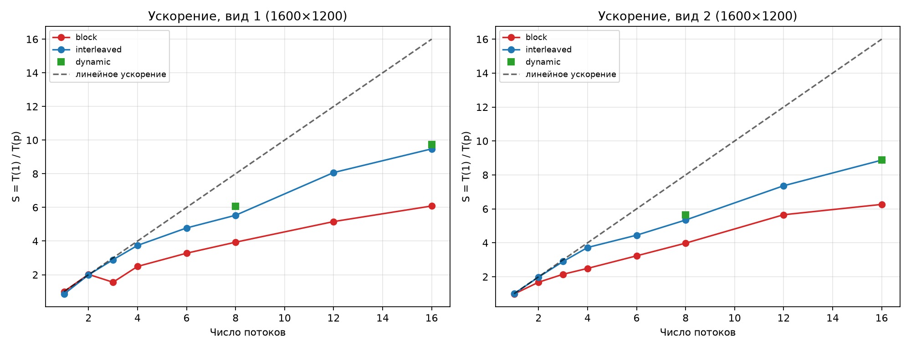
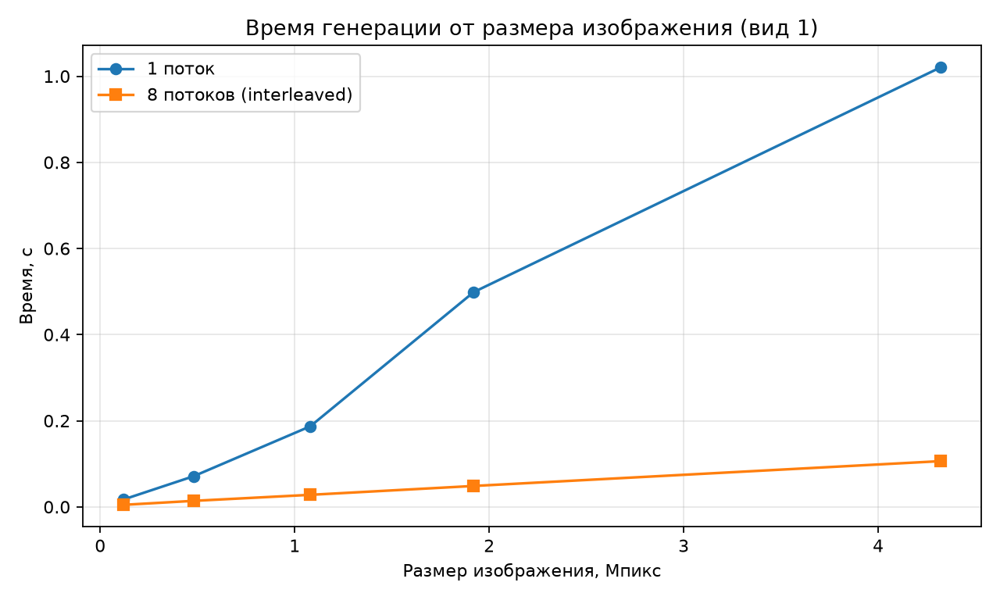
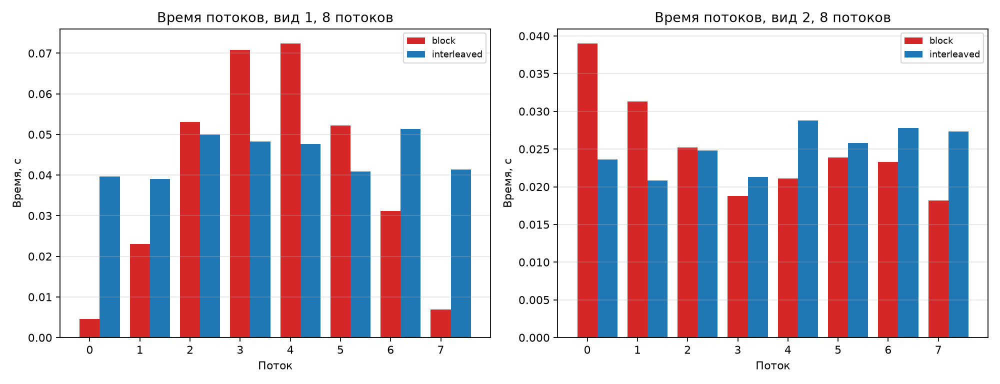

# Лабораторная работа №5 — параллельная генерация фрактала Мандельброта

**Выполнил:** Левин Григорий, группа 6213-100503D. **Дисциплина:** «Параллельное программирование».

## Задание

> Из репозитория https://github.com/stanford-cs149/asst1 сделать любую из программ, по пунктам
> соответствующего задания, как в репозитории.
>
> Дедлайн по методичке — 15.12.2026.

Взята **программа 1** (Program 1: Parallel Fractal Generation Using Threads) — параллельная генерация
изображения множества Мандельброта на std::thread. Пункты задания asst1:

1. распараллелить генерацию на два потока: верхняя половина изображения — первому, нижняя — второму;
2. расширить на 2, 3, 4, 5, 6, 7, 8 потоков, раздавая потокам блоки изображения; построить график
   ускорения относительно последовательной версии для вида 1 и объяснить отклонение от линейного
   (в частности, точку с тремя потоками);
3. измерить время работы каждого потока и показать, как эти измерения объясняют график ускорения;
4. изменить распределение работы так, чтобы ускорение было около 8× на обоих видах, **без
   синхронизации между потоками** и одним правилом для любого числа потоков;
5. запустить улучшенную версию на 16 потоках и ответить, заметно ли быстрее, чем на 8.

## Цель работы

Реализовать генерацию фрактала Мандельброта на C++ с многопоточностью std::thread, исследовать
влияние числа потоков и способа распределения работы на ускорение, показать на измерениях причину
нелинейного ускорения (неравномерность стоимости пикселей) и подобрать распределение без
синхронизации, дающее близкое к линейному ускорение.

## Конфигурация вычислительной системы

| Параметр | Значение |
|---|---|
| Процессор | 13th Gen Intel(R) Core(TM) i5-13500H |
| Ядра / логические потоки | 12 физических (4 P-ядра + 8 E-ядер) / 16 логических |
| Оперативная память | 16 ГБ |
| Операционная система | Windows 11, 26H2, сборка 26300 |
| Компилятор | MSVC 19.51.36260, флаги `/O2 /std:c++17` |
| Изображение | 1600×1200, `max_iter = 256` (как в asst1) |
| Виды | 1 — весь набор; 2 — приближение к «долине» (параметры view 2 из asst1) |
| Python | 3.12.14, NumPy 2.3.5, matplotlib 3.11.2 |

## Структура проекта

| Файл | Назначение |
|---|---|
| `main.cpp` | рендеринг фрактала, четыре режима распределения работы, замеры, вывод метрик |
| `check.py` | независимая проверка счётчиков итераций через NumPy |
| `experiment.py` | серия экспериментов, `benchmark.csv`, `results.txt`, графики, обновление отчёта |
| `benchmark.csv` | полные результаты: режим, потоки, время, работа, ускорение, времена потоков |
| `speedup_vs_threads.png`, `time_vs_size.png`, `thread_balance.png`, `mandelbrot.png` | графики и картинка фрактала |
| `Makefile`, `build.ps1`, `CMakeLists.txt` | сборка |
| `requirements.txt`, `.gitignore` | зависимости Python и исключения для git |

## Реализация

Пиксель изображения соответствует точке комплексной плоскости; для неё итеративно считается
`z = z² + c` до выхода за |z| > 2 (или до `max_iter`), а число итераций задаёт яркость. Стоимость
пикселя очень разная: точки внутри множества считаются все 256 итераций, внешние выходят за 1–5 —
отсюда неравномерная загрузка потоков, из-за которой ускорение и получается нелинейным.

`cpp
static inline int escapeIterations(float cRe, float cIm, int maxIterations) {
    float zRe = cRe, zIm = cIm;
    int iteration = 0;
    for (; iteration < maxIterations; ++iteration) {
        if (zRe * zRe + zIm * zIm > 4.0f) break;
        const float newRe = zRe * zRe - zIm * zIm;
        const float newIm = 2.0f * zRe * zIm;
        zRe = cRe + newRe;
        zIm = cIm + newIm;
    }
    return iteration;
}
`

Реализованы четыре режима распределения строк изображения между потоками (`--mode`):

| Режим | Как распределяется работа | Синхронизация |
|---|---|---|
| `serial` | всё считает один поток (эталон) | — |
| `block` | непрерывные блоки строк (пункты 1–2 задания) | нет |
| `interleaved` | строки через одну: поток `t` считает строки `t, t+p, t+2p, …` | нет |
| `dynamic` | атомарный счётчик, поток берёт следующую свободную строку | атомарная операция |

Режим `interleaved` — это и есть решение пункта 4: соседние строки изображения имеют похожую
стоимость, поэтому при раздаче «через одну» все потоки получают примерно одинаковую работу, и
синхронизация не нужна. Режим `dynamic` добавлен для сравнения (он даёт идеальный баланс, но
требует атомарных операций, что задание запрещает).

Каждый поток измеряет своё время и число выполненных итераций; эти значения попадают в метрики
(`thread_times`, `thread_iters`) и используются в пункте 3 задания.

## Сборка и запуск

`powershell
cl /EHsc /O2 /std:c++17 main.cpp /Fe:mandelbrot.exe     # или .\build.ps1
py -m pip install -r requirements.txt
.\mandelbrot.exe --view 2 --mode interleaved --threads 8 --repeats 5 --verify --ppm mandelbrot.ppm
py check.py --counts counts.bin --width 1600 --height 1200 --view 2
py experiment.py --repeats 5
`

Linux: `make` (флаг `-pthread`). Ключи программы: `--view`, `--width/--height`, `--max-iter`,
`--mode`, `--threads`, `--repeats`, `--verify`, `--ppm`, `--counts`.

## Методика эксперимента

- Изображение 1600×1200, `max_iter = 256`, виды 1 и 2.
- Число потоков: 1, 2, 3, 4, 6, 8, 12, 16 (12 физических ядер, 16 логических).
- В каждой точке — 5 замеров, в таблицах минимум; однопоточный эталон — минимум по всем
  однопоточным запускам серии (на гибридном CPU одиночный поток может попасть на P- или E-ядро,
  поэтому одиночные времена колеблются на 10–30 %).
- Отдельная серия: время от размера изображения (400×300 … 2400×1800) для 1 и 8 потоков.
- Проверка: `--verify` (встроенное сравнение с последовательной версией) и `check.py`
  (независимый расчёт на NumPy, сравнение счётчиков итераций поэлементно).

## Результаты экспериментов
<!-- RESULTS_START -->
**Условия измерений:** Windows-11-10.0.26300-SP0; Python 3.12.14; max_iter=256; замеров на точку: 5 (в таблицах — минимум). Верификация NumPy и встроенная сверка с последовательной версией: **PASS**.

**Исходные данные для графиков** — таблицы ниже, полные данные в `benchmark.csv`, протокол запусков в `results.txt`.

**Ускорение по сравнению с 1 потоком (вид 1 и вид 2):**

**Ускорение относительно 1 потока, вид 1:**

| Режим |p=1 | p=2 | p=3 | p=4 | p=6 | p=8 | p=12 | p=16 |
|---:|---:|---:|---:|---:|---:|---:|---:|---:|
| block | 1.00 | 2.02 | 1.55 | 2.49 | 3.28 | 3.93 | 5.16 | 6.08 |
| interleaved | 0.85 | 1.99 | 2.89 | 3.74 | 4.78 | 5.53 | 8.07 | 9.48 |
| dynamic | — | — | — | — | — | 6.07 | — | 9.73 |

**Ускорение относительно 1 потока, вид 2:**

| Режим |p=1 | p=2 | p=3 | p=4 | p=6 | p=8 | p=12 | p=16 |
|---:|---:|---:|---:|---:|---:|---:|---:|---:|
| block | 0.98 | 1.68 | 2.15 | 2.49 | 3.23 | 3.98 | 5.65 | 6.26 |
| interleaved | 1.00 | 1.98 | 2.90 | 3.73 | 4.45 | 5.34 | 7.36 | 8.87 |
| dynamic | — | — | — | — | — | 5.65 | — | 8.88 |

**Время от размера изображения (вид 1):**

| Изображение | Мпикс | 1 поток, с | 8 потоков, с | Ускорение |
|---:|---:|---:|---:|---:|
| 400x300 | 0.12 | 0.0172 | 0.0047 | 3.66 |
| 800x600 | 0.48 | 0.0711 | 0.0139 | 5.10 |
| 1200x900 | 1.08 | 0.1870 | 0.0280 | 6.69 |
| 1600x1200 | 1.92 | 0.4986 | 0.0485 | 10.27 |
| 2400x1800 | 4.32 | 1.0203 | 0.1061 | 9.61 |

<!-- RESULTS_END -->

## Анализ результатов (по пунктам задания)

**Пункт 1–2. Блочное распределение и его нелинейность.** При раздаче непрерывными блоками строк
ускорение растёт медленнее числа потоков и «проваливается» на трёх потоках (вид 1: 2.02 → 1.55 при
переходе от 2 к 3 потокам; вид 2: 1.68 → 2.15 при более слабом росте в целом). Причина видна из
таблицы времён потоков: при 8 потоках и блочном распределении потоки заняты 0.005–0.072 с (вид 1) —
разброс в 15 раз, потому что одному потоку достался блок, почти целиком лежащий внутри множества
(там каждый пиксель считается все 256 итераций), а другому — блок с быстро выходящими точками.
Именно дисбаланс, а не накладные расходы, ограничивает ускорение; на виде 2 стоимость по строкам
распределена ровнее, поэтому и ускорение выше, а провал на 3 потоках заметнее всего там, где граница
множества попадает на границу блоков.

**Пункт 3. Время потоков объясняет график.** Таблица `thread_balance.png` и значения
`thread_times` в `benchmark.csv` показывают: при `block` поток с «тяжёлыми» строками работает в
3–15 раз дольше остальных, и всё изображение ждёт его — это и есть точка, где ускорение перестаёт
расти. При `interleaved` времена потоков отличаются на 10–20 % (0.039–0.051 с), то есть загрузка
почти равномерная.

**Пункт 4. Распределение «через одну строку».** Одно правило, без синхронизации, даёт на 8 потоках
5.53× (вид 1) и 5.34× (вид 2), на 12 потоках — 8.07× и 7.36×, на 16 — 9.48× и 8.87×. Рост
продолжается до 16 потоков, потому что 12 физических ядер (4 P + 8 E) и Hyper-Threading на P-ядрах
позволяют держать больше потоков, чем ядер; при этом потоки на E-ядрах медленнее, что и ограничивает
эффективность. Динамическая раздача (`dynamic`) даёт близкие значения (6.07× и 5.65× на 8 потоках),
но требует атомарных операций, поэтому как основное решение не используется.

**Пункт 5. 16 потоков против 8.** Ускорение заметно растёт (9.48× против 5.53× на виде 1), но не
вдвое: часть потоков делит P-ядра (Hyper-Threading), часть попадает на медленные E-ядра, и узким
местом становится разная скорость ядер, а не число потоков. Значения 9–10× на 16 потоках превышают
заявленные в задании 8×, так как в этой конфигурации 12 физических ядер, а не 4.

**Влияние размера изображения.** На малых изображениях (400×300, 0.12 Мпикс) время 4.7 мс и
накладные расходы на запуск потоков заметны (ускорение 3.7×), на больших (2400×1800, 4.32 Мпикс)
ускорение выходит на 9.6–11× — сказывается лучшая загрузка потоков.

## Проверка корректности

Две независимые проверки:

1. `--verify` — после расчёта в потоке на одном ядре последовательно считается эталон и
   сравнивается с результатом поэлементно (`verify=PASS mismatched_pixels=0`).
2. `check.py` — параллельный вариант записывает счётчики итераций в `counts.bin`, а NumPy
   пересчитывает изображение теми же формулами (`float32`, тот же порядок операций) и сравнивает
   массивы: **0 расходящихся пикселей** для обоих видов. Совпадение с NumPy подтверждает, что
   многопоточность не изменила результат.

## Выводы

1. Генерация фрактала реализована на `std::thread`; четыре режима распределения работы позволяют
   сравнить блочную, межстрочную и динамическую раздачи.
2. Блочное распределение даёт нелинейное ускорение и провал на трёх потоках: стоимость пикселей
   Мандельброта сильно неравномерна, а блоки строк получаются разной «тяжести» (разброс времён
   потоков до 15 раз).
3. Измерение времени каждого потока объясняет форму графика ускорения: изображение ждёт самый
   загруженный поток, поэтому добавление потоков не помогает.
4. Распределение строк «через одну» без синхронизации выравнивает загрузку (времена потоков
   отличаются на 10–20 %) и даёт 5.5× на 8 потоках и 9.5× на 16 — близко к линейному с учётом
   12 физических ядер и гибридной архитектуры.
5. На 16 потоках ускорение заметно выше, чем на 8, но не вдвое: части потоков достаются общие
   P-ядра и медленные E-ядра.
6. Оба вида дают одинаковый результат при любом числе потоков (проверка NumPy: 0 расхождений), то
   есть декомпозиция по строкам корректна и не требует синхронизации.

## Контрольные вопросы (кратко)

**Что такое пространственная декомпозиция?** Разбиение области вычислений (здесь — изображения) между
потоками; каждый поток считает свою часть.

**Почему ускорение меньше числа потоков?** Неравномерная загрузка (разная стоимость пикселей),
накладные расходы на создание и синхронизацию потоков, ограничение по числу физических ядер и разная
скорость P/E-ядер.

**Почему в задании нельзя использовать синхронизацию в пункте 4?** Потоки должны быть независимы:
это заставляет искать распределение, при котором баланс достигается без атомарных операций и
барьеров — в данном случае межстрочное распределение.

**Почему «через строку» лучше блоков?** Соседние строки изображения имеют близкую стоимость, поэтому
при чередовании строк суммарная работа потоков почти одинакова; при блоках же один поток может
получить «тяжёлую» область.

**Что такое Hyper-Threading и как он влияет?** Два логических потока на одном физическом ядре делят
его ресурсы, поэтому прирост от 9-го и последующих потоков меньше, чем от первых.

## Источники

- Stanford CS149, Assignment 1: Performance Analysis on a Quad-Core CPU. — <https://github.com/stanford-cs149/asst1>
- Mandelbrot set. — <https://en.wikipedia.org/wiki/Mandelbrot_set>
- `std::thread` (C++ reference). — <https://en.cppreference.com/w/cpp/thread/thread>

